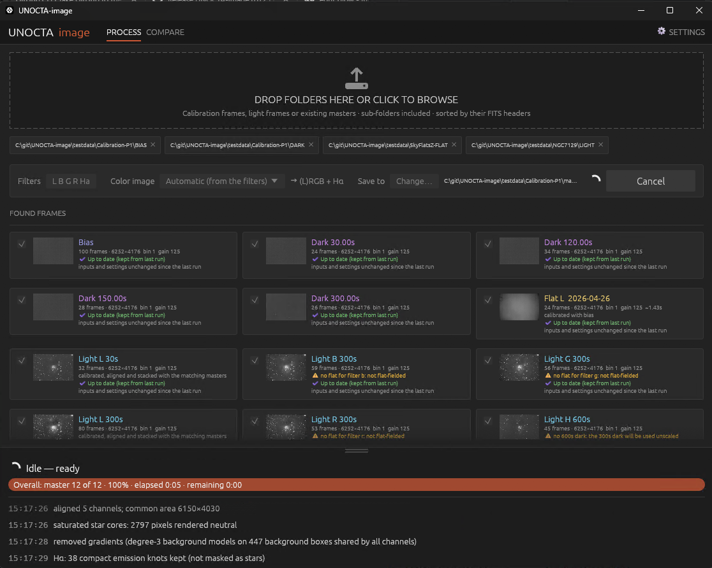
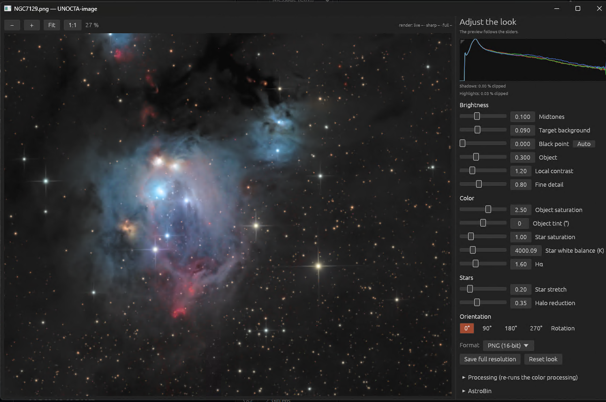

# UNOCTA-image

**From raw astro frames to a finished color image, in one click.**

Point UNOCTA at your folders of bias, dark, flat and light frames. It sorts them by their FITS
headers, builds the calibration masters, calibrates, aligns and stacks your lights, and makes a
color image you can fine-tune with a few sliders. Careful, high-quality processing without
the learning curve.


<sub>NGC 7129: L, R, G, B and Hα frames, processed by UNOCTA-image with default settings (RC Astro tools installed).</sub>

## Download

<p align="center">
<a href="https://github.com/photon1503/unocta-image-release/releases/latest/download/unocta-windows-x86_64.exe"></a>
<a href="https://github.com/photon1503/unocta-image-release/releases/latest/download/unocta-macos-arm64"></a>
<a href="https://github.com/photon1503/unocta-image-release/releases/latest/download/unocta-macos-x86_64"></a>
<a href="https://github.com/photon1503/unocta-image-release/releases/latest/download/unocta-linux-x86_64"></a>
</p>

The buttons always download the newest version. It is the whole program: no installer.
Not sure which Mac you have? Apple menu → *About This Mac*: "Chip: Apple M…" means Apple Silicon.
All versions and their release notes: [releases](https://github.com/photon1503/unocta-image-release/releases).

**Windows:** double-click the file. If SmartScreen warns about an unknown app, click
*More info → Run anyway*.

**Mac:** open Terminal in the download folder and run once:
```sh
chmod +x unocta-macos-arm64
xattr -d com.apple.quarantine unocta-macos-arm64
./unocta-macos-arm64
```

**Linux:** `chmod +x unocta-linux-x86_64`, then start it.

## How it works



1. **Drop your folders** on the window (or click the dashed area to choose them).
   Sub-folders are included; frames are recognized from their FITS headers.
2. **Check what was found.** Each group shows its frame count and how it will be used.
   Untick anything you don't want.
3. **Click *Start processing*.** Masters and stacked lights are saved to the output folder
   (XISF or FITS). When there are color filters, the color image opens with sliders for
   brightness, color and stars. Save it as PNG, TIFF, XISF or FITS.



Recognized filters: L, R, G, B, Hα, OIII, SII (also spelled Lum, Red, H-alpha, "Ha 7nm", …).
If a name isn't recognized, UNOCTA asks once and remembers.

**Optional:** with RC Astro's command-line tool `rc-astro` installed and licensed,
BlurXTerminator, NoiseXTerminator and StarXTerminator are used automatically.

## Updates

UNOCTA checks at start whether a newer version is available. If so, an **Update** button
appears at the top. It shows what changed and installs only when you confirm. Your settings
stay. Turn the check off under **Settings → Updates**.

## Good to know

- Your original frames are only read, never changed.
- Nothing is sent anywhere, except the update check.
- What changed in each version: see the [releases](https://github.com/photon1503/unocta-image-release/releases).
