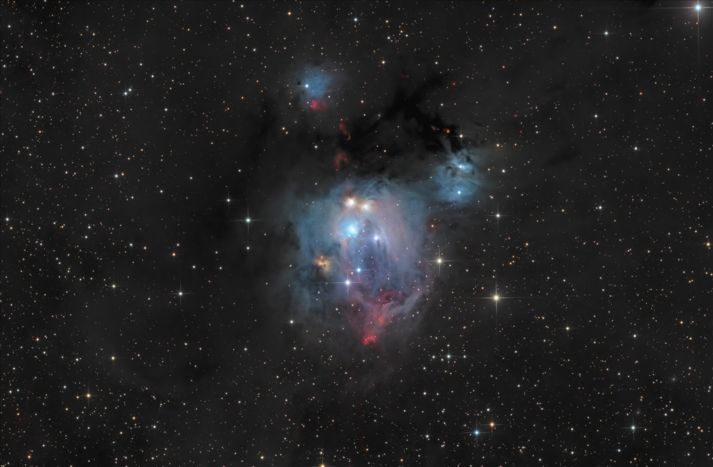
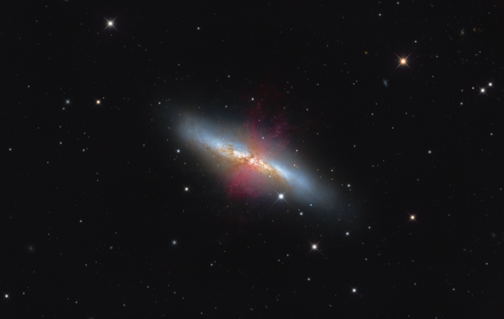
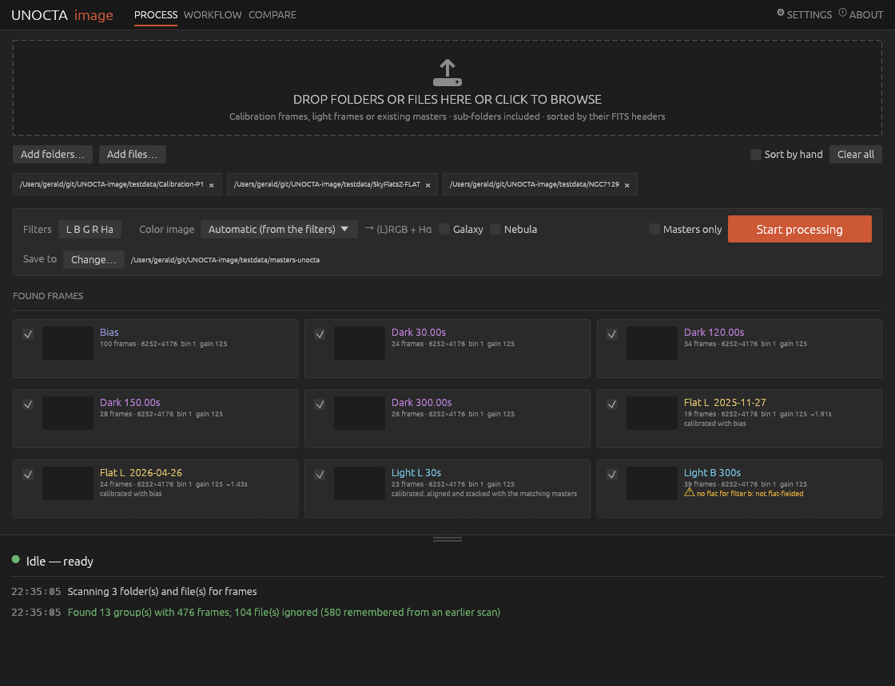
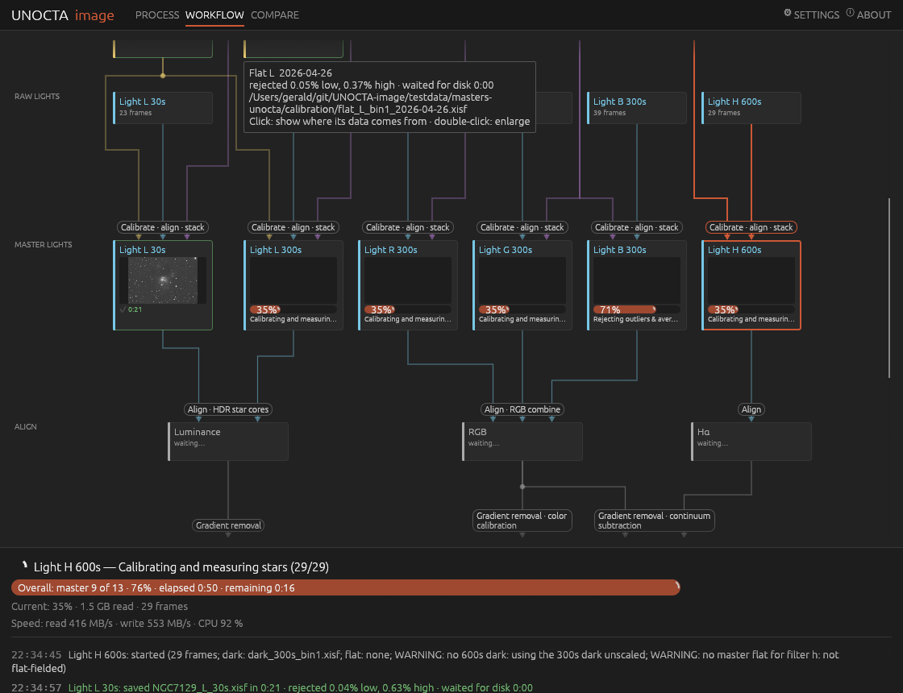
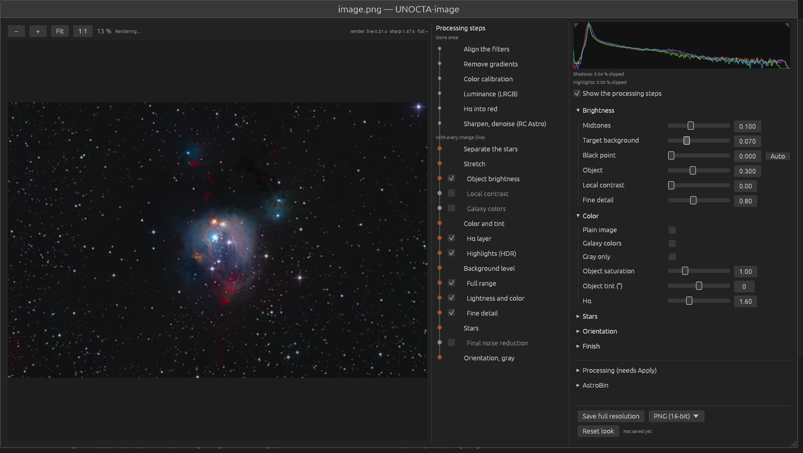

# UNOCTA-image

**From raw astro frames to a finished color image, in one click.**

Point UNOCTA at your folders of bias, dark, flat and light frames. It sorts them by their FITS
headers, builds the calibration masters, calibrates, aligns and stacks your lights, and makes a
color image you can fine-tune with a few sliders. Careful, high-quality processing without
the learning curve.


<sub>NGC 7129: L, R, G, B and Hα frames, processed by UNOCTA-image with default settings (RC Astro tools installed).</sub>

## Download

<p align="center">
<a href="https://github.com/photon1503/unocta-image-release/releases/latest/download/unocta-windows-x86_64.exe"></a>
<a href="https://github.com/photon1503/unocta-image-release/releases/latest/download/unocta-macos-arm64"></a>
<a href="https://github.com/photon1503/unocta-image-release/releases/latest/download/unocta-macos-x86_64"></a>
<a href="https://github.com/photon1503/unocta-image-release/releases/latest/download/unocta-linux-x86_64"></a>
</p>

The buttons always download the newest version. It is the whole program: no installer.
Not sure which Mac you have? Apple menu → *About This Mac*: "Chip: Apple M…" means Apple Silicon.
All versions and their release notes: [releases](https://github.com/photon1503/unocta-image-release/releases).

**Windows:** double-click the file. If SmartScreen warns about an unknown app, click
*More info → Run anyway*.

**Mac:** open Terminal in the download folder and run once:
```sh
chmod +x unocta-macos-arm64
xattr -d com.apple.quarantine unocta-macos-arm64
./unocta-macos-arm64
```

**Linux:** `chmod +x unocta-linux-x86_64`, then start it.

## What it does

- **Sorts your frames by itself.** Bias, dark, dark flat, flat and light frames are recognized
  and grouped from their FITS headers (type, exposure, filter, binning, gain, night).
- **Calibration masters** built the way PixInsight's WBPP builds them. Masters you already have
  (UNOCTA's or PixInsight's, XISF or FITS) can be dropped in as well and are used as they are.
- **Master lights:** your lights are calibrated, aligned, brightness-matched and stacked into one
  master light per filter. All filters line up and have the same size.
- **Mosaics:** panels of one target are found from where the telescope pointed and joined
  into one image. See [Mosaics](#mosaics).
- **A finished color image:** LRGB, RGB, Hα added to RGB, and narrowband (SHO, HOO), with
  gradient removal and color calibration from the stars. Looks for galaxies, for nebulae that
  fill the frame, and a *Plain image* that shows the data as recorded.
- **Live fine-tuning:** the picture follows every slider at once. The processing steps are
  listed next to it; click one to see what it does, or switch it off.
- **Nothing is done twice:** every stage keeps its results. A stopped run continues where it
  was, and masters whose frames have not changed are kept.
- **Open formats:** masters as XISF or FITS (they load straight into PixInsight), the color
  image as PNG, TIFF, XISF or FITS, plus a ready-made upload set for AstroBin.


<sub>M 82: L, R, G, B and Hα frames, with the galaxy look.</sub>

## How it works



1. **Drop your folders or files** on the window (or click the dashed area to choose them).
   Sub-folders are included; frames are recognized from their FITS headers.
2. **Check what was found.** Each group shows its frame count and how it will be used, with a
   warning when something is missing (for example no flat for a filter).
   Untick anything you don't want.
3. **Click *Start processing*.** Masters and stacked lights are saved to the output folder
   (XISF or FITS). When there are color filters, the color image opens with sliders for
   brightness, color and stars. Save it as PNG, TIFF, XISF or FITS.

Next to *Start processing*:

- **Color image** chooses how the filters are combined. *Automatic* picks it from the filters found.
- **Galaxy** makes a galaxy's own light white, so old cores come out cream and young spiral arms blue.
- **Nebula** is for a nebula that fills the whole frame: the darkest part of the field is taken as the sky.
- **Masters only** stops after the calibration masters and master lights, without a color image.

Recognized filters: L, R, G, B, Hα, OIII, SII (also spelled Lum, Red, H-alpha, "Ha 7nm", …).
If a name isn't recognized, UNOCTA asks once and remembers. Photometric filters
(Johnson B/V, Cousins Rc, Sloan r′/g′) are recognized too, and their colors are converted.

**Frame type missing or wrong in the headers?** Tick **Sort by hand**: the drop area becomes four
baskets (bias, darks, flats, lights), and the basket decides what a frame is.

### Watch the run



The **Workflow** tab shows the run from top to bottom: raw frames, calibration masters, one
master light per filter, then the steps of the color image. Each box has its preview and
progress. Click a box to see where its data comes from; double-click to enlarge its preview.
Below it you always see what is happening right now, the time remaining and the read speed.

### The color image



The window opens as soon as the color image is started and follows it: the list shows which
step is running, the picture shows the image at that moment. When it is finished:

- **Sliders** for brightness (midtones, background, black point, object, contrast, detail),
  color (saturation, tint, Hα) and stars (size, color, halos). The picture follows at once.
- **Processing steps** lists everything that was done, in order. Click a step for what it does
  and its settings. Steps that can be left out have a switch.
- **Plain image** shows the data as recorded: only gradient removal, color calibration and one
  stretch. Nothing is removed or added.
- **Gray only** makes a black-and-white image.
- **SHO colors** for narrowband: Gold + Hubble, Gold, Hubble, Natural or Foraxx.
- **Show the starless image** (with StarXTerminator) shows and saves the image without its stars.
- **Histogram** with a warning when shadows or highlights are clipped.
- **Save full resolution** as PNG or TIFF (16-bit), XISF or FITS (32-bit).
- **AstroBin** writes a full-resolution JPEG, the acquisition table in AstroBin's CSV import
  format and a description, then opens AstroBin's upload page. Nothing is uploaded for you.

**Optional:** with RC Astro's command-line tool `rc-astro` installed and licensed,
BlurXTerminator, NoiseXTerminator and StarXTerminator are used automatically. Without it,
UNOCTA uses its own sharpening, noise reduction and star handling.

## Mosaics

Drop the frames of all panels together. UNOCTA reads where the telescope pointed, shows each
group as "panel 3 of 7", and *Start processing* makes the master lights of every panel, the
mosaic for each filter and the color image.

- Panels are placed by their stars. A panel whose overlap is too narrow for that is placed from
  the telescope's pointing and confirmed by the stars there.
- Brightness is matched in the overlaps and the edges are blended, so no seams remain.
- After the run, a map shows where each panel went, and which panels were left out and why.
- A mosaic too large for the computer's memory gets its color image from a reduced copy.
  The full-resolution mosaic is always kept.
- Single frames pointed a little off the others (re-centered after a meridian flip, for example)
  are skipped and listed, not turned into a panel of their own.

The panel master lights go to `panel-1/`, `panel-2/`, … in the output folder, the mosaic itself
(`M42_B.xisf`) next to them. Already have master lights of each panel? See
[`unocta mosaic`](#unocta-mosaic-panels--o-out).

## Output folder

By default a folder `masters-unocta` next to your frames; **Save to** changes it. Never inside
your input folders.

| | |
|---|---|
| `M42_B.xisf`, `M42_B_autocrop.xisf` | Master lights: object and filter. The auto-cropped copy has the same size for every filter. |
| `M42.png`, `M42_linear.xisf` | The color image, and the same before stretching. |
| `calibration/` | Calibration masters: `bias_bin1.xisf`, `dark_300s_bin1.xisf`, `flat_R_bin1.xisf`. |
| `panel-1/`, `panel-2/`, … | A mosaic's panel master lights. |
| `registered/` | The aligned single frames, kept so a repeated run is faster. |
| `astrobin/` | The AstroBin upload set. |
| `masters.log`, `lights.log`, `compose.log` | What each run did, with its settings. |

**Settings → Also save R, G and B as one unprocessed RGB image** adds `<object>_RGB_unprocessed`
(TIFF, XISF or FITS): only aligned and cropped, for your own processing in PixInsight, Siril or
elsewhere.

## Updates

UNOCTA checks at start whether a newer version is available. If so, an **Update** button
appears at the top. It shows what changed and installs only when you confirm. Your settings
stay. Turn the check off under **Settings → Updates**.

## Good to know

- Your original frames are only read, never changed.
- Nothing is sent anywhere, except the update check.
- Your settings and last folders are remembered. **Settings → Reset to defaults** goes back.
- **About** (top right) has the description of every processing step and the release notes.
- What changed in each version: see the [releases](https://github.com/photon1503/unocta-image-release/releases).

## Command line

The same program also runs from a terminal, for scripts and batch work. Without arguments it
opens the window. In the examples, `unocta` stands for the downloaded file
(e.g. `./unocta-macos-arm64` or `unocta-windows-x86_64.exe`).

```sh
unocta scan /data/M31                                     # what was found
unocta masters /data/calibration -o /data/masters         # calibration masters
unocta lights /data/M31 -m /data/masters -o /data/stacked # calibrated, stacked lights
unocta mosaic /data/M42/p1 /data/M42/p2 -o /data/M42/all  # join the panels of a mosaic
unocta compose /data/stacked -o /data/final --name M31    # finished color image
```

`unocta --help` and `unocta <command> --help` list everything below. `unocta --version` shows the version.

### `unocta gui [FOLDERS…]`

Opens the window, with these folders or files already added.

```sh
unocta gui /data/2026-10-12 /data/calibration
```

### `unocta scan [FOLDERS…]`

Lists the groups of frames (bias, darks, flats, lights) found in the folders or files. Changes nothing.

```sh
unocta scan /data/NGC7129 /data/calibration
```

### `unocta masters [FOLDERS…] -o OUT`

Builds master bias, dark, dark flat and flat frames.

| Option | Meaning |
|---|---|
| `-o, --out FOLDER` | Output folder (required). |
| `--format xisf\|fits` | File format of the masters. Default: `xisf`. |
| `--rebuild` | Build masters again even if an up-to-date one is already in the output folder. |
| `--flat-rejection linear\|winsorized\|none` | Outlier rejection for flats. Default: `linear` (as in PixInsight's WBPP). |
| `--no-flat-calibration` | Do not subtract the master bias from the flats. |
| `--flat-calibration-frame FILE` | Calibrate the flats with this existing master (FITS/XISF) instead. |
| `--scale-darks-for-flats` | If there is no dark flat or dark with the flats' exposure, use bias + the nearest dark, scaled to the flat exposure. |
| `--flats PATHS…`, `--darks PATHS…`, `--bias PATHS…` | Folders or files that are flats, darks or bias frames whatever their headers say (like **Sort by hand** in the window; e.g. sky flats saved as lights). |

```sh
# Masters as FITS, built again from scratch
unocta masters /data/calibration -o /data/masters --format fits --rebuild

# Flats without dark flats: calibrate them with bias + a scaled dark
unocta masters /data/calibration -o /data/masters --scale-darks-for-flats

# Sky flats that were saved as light frames
unocta masters /data/calibration -o /data/masters --flats /data/skyflats
```

### `unocta lights [FOLDERS…] -m MASTERS -o OUT`

Calibrates, aligns and stacks the light frames into one master light per filter.

| Option | Meaning |
|---|---|
| `-m, --masters FOLDER` | Folder with the calibration masters (required; can be given more than once). |
| `-o, --out FOLDER` | Output folder (required). |
| `--format xisf\|fits` | File format of the master lights. Default: `xisf`. |
| `--clean` | Delete the aligned single frames after a successful run. By default they are kept, so a repeated run is faster. |
| `--no-local-normalization` | Match the frames' brightness with one offset and scale per frame instead of local normalization. |
| `--unprocessed-rgb tiff\|xisf\|fits` | Also save R, G and B as one RGB image, only aligned and cropped. |

```sh
# Stack two nights with masters from two folders, delete the aligned frames afterwards
unocta lights /data/NGC7129/night1 /data/NGC7129/night2 \
  -m /data/masters/2026-10 -m /data/masters/darks -o /data/NGC7129/stacked --clean

# Also save an unprocessed RGB TIFF for your own processing
unocta lights /data/M82 -m /data/masters -o /data/M82/stacked --unprocessed-rgb tiff
```

### `unocta mosaic [PANELS…] -o OUT`

Joins the panels of one target into a mosaic. Each folder holds one panel's master lights; the
result is one master light for every filter that all panels have. Then make the color image
with `unocta compose`. (From raw frames, `unocta gui` does all of this in one run.)

```sh
unocta mosaic /data/M42/panel-1 /data/M42/panel-2 /data/M42/panel-3 -o /data/M42/mosaic
unocta compose /data/M42/mosaic -o /data/M42/final --name M42 --nebula-fill
```

### `unocta compose [FOLDERS…] -o OUT`

Makes the finished color image from master lights (L, R, G, B, Hα, OIII, SII, picked by their
filter names). Writes `<name>.png` (stretched, 16-bit), `<name>.jpg` and `<name>_linear.xisf` (linear RGB).
Options left out use the same automatic settings as the window; some of them depend on the
image type (broadband, narrowband, galaxy). The defaults below are for nebulae;
`--galaxy-white` changes those for stretch, sky level, object and stars.

| Option | Meaning |
|---|---|
| `-o, --out FOLDER` | Output folder (required). |
| `--name NAME` | File name of the result. Default: `composite`. |
| `--palette auto\|rgb\|lrgb\|halrgb\|sho\|hoo` | How the filters are combined. Default: `auto`. |
| `--sho-colors gold-hubble\|gold\|hubble\|natural\|foraxx` | Colors of an SHO image. Default: `gold-hubble`. |
| `--filters auto\|rgb\|photometric` | Color filters: recognized from the names, imaging RGB, or photometric (Johnson/Cousins, Sloan). Default: `auto`. |
| `--galaxy-white` | Make a galaxy's overall light white (instead of the color of a Sun-like star), with the galaxy look. |
| `--nebula-fill` | The nebula fills the whole frame: take the darkest part as the sky instead of the median. Makes a plain image unless `--full` is given. |
| `--plain` | Plain image: only gradient removal, color calibration and one stretch. Nothing is removed or added. Not for narrowband. |
| `--full` | Full processing also with `--nebula-fill`. |
| `--gray` | A black-and-white image (always for luminance-only data). |
| `--unprocessed-rgb tiff\|xisf\|fits` | Also save `<name>_RGB_unprocessed`: R, G and B only aligned and cropped. |
| **Brightness** | |
| `--background N` | Midtones: where the sky sits on the stretch curve (0–1); sets the stretch strength. Default: 0.10. |
| `--sky-level N` | Brightness of the darkest sky in the result (0–0.5). Default: 0.059 (≈ 15/255). |
| `--object N` | Target brightness of the object (0–1). |
| `--black-point N` | This level and darker becomes black (0–0.3). Default: 0. |
| `--core-detail N` | Galaxies: 1 shows all of the core's structure (default), 0 keeps a brighter, glowing core. |
| **Color** | |
| `--saturation N` | Color saturation of the nebula/galaxy. |
| `--star-saturation N` | Color saturation of the stars. Default: 1.0. |
| `--nebula-temperature K` | White balance of the object, as the assumed temperature of the average star (lower = warmer). Default: automatic. |
| `--star-temperature K` | White balance of the stars, separately (lower = warmer). Default: automatic. |
| `--object-hue DEG` | Rotate the object's hue, not the stars' (−180 to 180°). Default: 0. |
| `--ha-strength N` | How much of the Hα signal is added to red (0 = none). Default: 3. |
| `--ha-blend N` | Strength of the stretched Hα layer added to red (0 = off). |
| **Stars** | |
| `--star-stretch N` | Star stretch relative to the nebula (smaller = smaller stars). Default: 0.5. |
| `--halo-reduction N` | How much of bright stars' halos is removed (0–1). Default: 0.35. |
| **Detail and noise** | |
| `--contrast N` | Local contrast on the object (0 = none). Default: 0. |
| `--detail N` | Fine-detail enhancement on the object (0 = none). Default: 0.8. |
| `--noise-reduction N` | Noise reduction threshold in σ (0 = off). Default: 2. |
| `--deconvolution N` | Sharpening iterations (Richardson–Lucy) on the luminance (0 = none). Default: 0. |
| **RC Astro tools** (used when `rc-astro` is installed) | |
| `--no-rc-astro` | Don't use BlurXTerminator, NoiseXTerminator and StarXTerminator. |
| `--bxt-stars N` | BlurXTerminator "sharpen stars" (0–0.7). Default: 0.5. |
| `--bxt-nonstellar N` | BlurXTerminator "sharpen nonstellar" (0–1). Default: 0.5. |
| `--nxt-denoise N` | NoiseXTerminator "denoise" (0–1), before stretching. Default: 0.15. |
| `--nxt-final N` | NoiseXTerminator also on the finished image (0–1; 0.8 is a good strength). Default: 0 (off). |
| **Output** | |
| `--rotate 0\|90\|180\|270` | Rotate the finished image clockwise (the linear XISF keeps the original orientation). Default: 0. |
| **AstroBin** | |
| `--astrobin FOLDER` | Also write an AstroBin upload set to this folder: `<name>.jpg` (full resolution), `acquisition.csv` (AstroBin's CSV import format) and `description.txt`. Nothing is uploaded. The filter IDs come from the window's saved AstroBin settings. |
| `--jpeg-quality N` | JPEG quality of the AstroBin image, 1–100 (default 90). Higher keeps more fine detail and makes a larger file. In the window: **JPEG quality** in the AstroBin section, remembered. |
| `--frames FOLDER…` | Folders with the light and calibration frames, for the AstroBin table's nights and calibration frame counts. Without it, the table is made from the master lights (one row per master light, no dates). |

```sh
# Nebula with default settings
unocta compose /data/NGC7129/stacked -o /data/NGC7129/final --name NGC7129

# Galaxy: white galaxy light, a darker sky, turned a quarter clockwise
unocta compose /data/M82/stacked -o /data/M82/final --name M82 --galaxy-white --sky-level 0.06 --rotate 90

# The data as recorded, nothing removed or added
unocta compose /data/M42/stacked -o /data/M42/final --name M42 --plain

# Narrowband in Hubble colors, a bit more saturated, without RC Astro's tools
unocta compose /data/Veil/stacked -o /data/Veil/final --name Veil \
  --palette sho --sho-colors hubble --saturation 1.6 --no-rc-astro

# Warmer stars, smaller star halos, a little sharpening of the luminance
unocta compose /data/M31/stacked -o /data/M31/final --name M31 \
  --star-temperature 3500 --halo-reduction 0.6 --deconvolution 10

# Finished image plus an AstroBin upload set, with nights and calibration counts from the raw frames
unocta compose /data/Veil/stacked -o /data/Veil/final --name Veil \
  --astrobin /data/Veil/astrobin --frames /data/Veil/lights /data/calibration
```

### `unocta compare A B`

Compares two images pixel by pixel and prints the differences (in 16-bit ADU).

```sh
unocta compare /data/masters/calibration/flat_L_bin1.xisf /data/pixinsight/masterFlat_L.xisf
```

### `unocta update [--yes]`

Checks for a newer version and installs it after asking. `--yes` installs without asking.

```sh
unocta update          # asks before installing
unocta update --yes    # e.g. from a script
```
